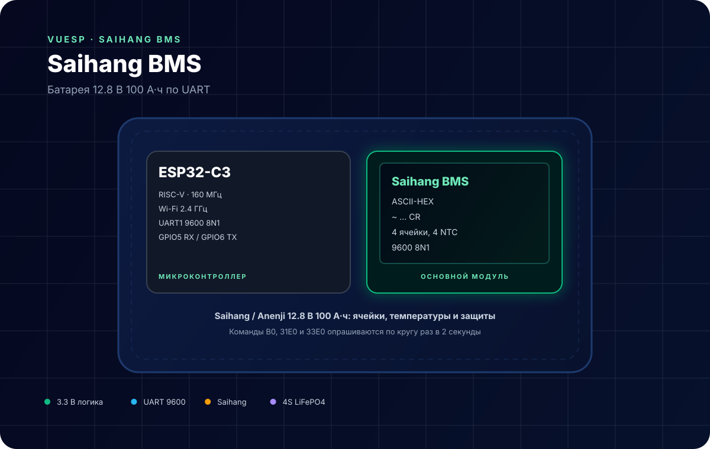
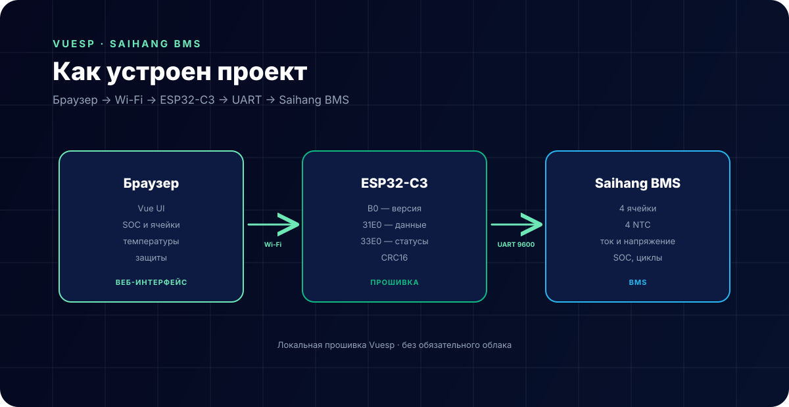

# Saihang BMS — батарея 12.8 В 100 А·ч



**Коротко:** `vuesp.shinwa-bms` — прошивка Vuesp для BMS **Saihang** (батарея Anenji 12.8 В 100 А·ч LiFePO4). ESP32-C3 общается с BMS по UART ASCII-HEX протоколу, читает 4 ячейки, 4 температуры, ток, напряжение, ёмкость, SOC и битовые статусы защит.

## Что это за устройство

Saihang BMS стоит внутри готовых LiFePO4-батарей (в том числе Anenji 12.8 В 100 А·ч). У неё есть UART/RS232-порт с текстовым протоколом:

- кадр начинается символом `~` (`0x7E`) и заканчивается `\r` (`0x0D`);
- данные передаются ASCII-HEX символами;
- скорость 9600 8N1;
- CRC — четыре ASCII-символа перед `\r`.

Прошивка по кругу отправляет три команды:

| Команда | Назначение |
| --- | --- |
| `B0` | версия прошивки BMS |
| `31E0` | основные данные: ячейки, температуры, ток, напряжение, ёмкость |
| `33E0` | статусы: защиты, предупреждения, состояние MOSFET |

## Характеристики

| Параметр | Значение |
| --- | --- |
| Микроконтроллер | ESP32-C3 (RISC-V, 160 МГц) |
| Батарея | LiFePO4 12.8 В, 4S |
| BMS | Saihang / Anenji |
| Интерфейс | UART, 9600 8N1 |
| Формат | ASCII-HEX, `~ … \r` |
| Ячейки | 4 (фиксировано) |
| Температуры | 4 NTC |
| Среда | PlatformIO + Arduino |

## Распиновка

| Сигнал | GPIO ESP32-C3 | Куда |
| --- | --- | --- |
| RX | GPIO5 | TX BMS |
| TX | GPIO6 | RX BMS |
| GND | GND | GND BMS |

```cpp
Serial1.begin(9600, SERIAL_8N1, 5, 6);
```

> **Важно.** Если у батареи выход RS232 (DB9 или 3-контактный разъём), между BMS и ESP32-C3 нужен преобразователь уровней RS232 ↔ TTL (например, MAX3232). Подключать RS232 напрямую к GPIO нельзя — это другой уровень сигнала.

## Схема подключения

```text
BMS TX   ─────────►  GPIO5 (RX) ESP32-C3
BMS RX   ◄─────────  GPIO6 (TX) ESP32-C3
BMS GND  ───────────  GND
```

- TX/RX — накрест, GND обязателен.
- Питание ESP32-C3 — отдельное 5 В; порт BMS не является источником питания.
- Для RS232-версии: BMS → MAX3232 → GPIO5/GPIO6.

## Протокол

Команды в прошивке (`src/device/device.cpp`):

| Команда | Байты (ASCII) |
| --- | --- |
| Model | `~120146110000FDB0` |
| Version | `~120146B00000FDA0` |
| Serial | `~120146B10000FD9F` |
| Main data | `~12014631E00201FD36` |
| Statuses | `~12014633E00201FD34` |

Проверка кадра (`checkFrame`):

1. последние 4 символа перед `\r` — CRC в ASCII-HEX;
2. сумма ASCII-кодов с индекса 1 до `len - 5`;
3. `crc = ~(sum % 65536) + 1`;
4. CRC должен совпасть.

Разбор основного кадра (`parseMessageMain`, смещения — как в прошивке):

| Поле | Смещение | Длина | Единицы |
| --- | --- | --- | --- |
| Ячейка 1–4 | 19, 23, 27, 31 | 4 | мВ |
| Температура 1–4 | 37, 41, 45, 49 | 4 | `raw − 2730`, 0.1 °C |
| Ток | 53 | 8 | 10 мА, знаковый |
| Напряжение | 65 | 4 | мВ |
| Ёмкость | 73 | 4 | 10 мА·ч |
| FCC | 83 | 4 | 10 мА·ч |
| Циклы | 87 | 4 | шт. |
| DCC | 95 | 4 | 10 мА·ч |
| SOC | 99 | 2 | % |

Кадр статусов (`parseMessageAlarm`) содержит количество ячеек и температур и девять байтовых масок: `status1…status9`, а также `cellStatus1…4`, `tempStatus1…4`, `chgCurrStatus`, `totalVoltStatus`, `dsgCurrStatus`.

Расшифровка масок — в `src/device/device.h`:

| Маска | Пример бита | Значение |
| --- | --- | --- |
| `status1` | `0x80` | высокое напряжение зарядки |
| `status1` | `0x08` | перенапряжение |
| `status1` | `0x04` | пониженное напряжение |
| `status1` | `0x02` | низкое напряжение ячейки |
| `status2` | `0x01` | высокая температура заряда |
| `status3` | `0x02` | зарядный MOSFET включён |
| `status3` | `0x04` | разрядный MOSFET включён |
| `status3` | `0x80` | есть напряжение в сети |

В dashboard состояние MOSFET выводится по битам `status3` (`v & 2`, `v & 4`).

## Как устроен проект



- `src/device/device.cpp` — команды, приём кадра, CRC, разбор;
- `src/device/device.h` — маски статусов;
- `src/const/struct.h` — структура `Device`;
- `vue/json/dashboard.json` — плитки ячеек, температур, тока и статусов;
- `vue/` — веб-интерфейс Vuesp.

Опрос идёт по кругу: `B0` → `31E0` → `33E0` → снова `B0`, раз в 2 секунды.

## ScriptRunner

| Функция | Назначение |
| --- | --- |
| `http(method, url, count, num, data)` | заготовка HTTP-запроса |
| `$display` | строковый буфер для сценариев |

Пример:

```text
log('bms ready');
```

## Сборка и прошивка

```bash
cd vue
npm ci
npm run build-web

cd ..
~/.platformio/penv/bin/pio run
~/.platformio/penv/bin/pio run -t buildfs
```

Прошивка: `build/esp32-c3-devkitm-1/firmware.bin`, FS: `build/esp32-c3-devkitm-1/littlefs.bin`.

Полная сборка:

```bash
cd vue
npm run build
```

## Ограничения

- Протокол рассчитан на **4 ячейки**; структура и dashboard жёстко завязаны на `cell1…cell4`.
- CRC проверяется по ASCII-сумме; при помехах кадр отбрасывается целиком.
- Только чтение: команды балансировки и управления MOSFET не отправляются.
- Некоторые поля (FCC, DCC) читаются, но не выводятся в dashboard.
- Версия BMS — строка из 32 символов; в UI показывается не на всех плитках.
- Для RS232-версии батареи обязателен преобразователь уровней.

## Источники

- [Anenji 12.8 В 100 А·ч — описание батареи](https://anenji.com/)
- [Saihang BMS protocol (ASCII-HEX)](https://github.com/bondrogeen/vuesp.shinwa-bms)
- [Документация Vuesp](https://docs.vuesp.ru)
